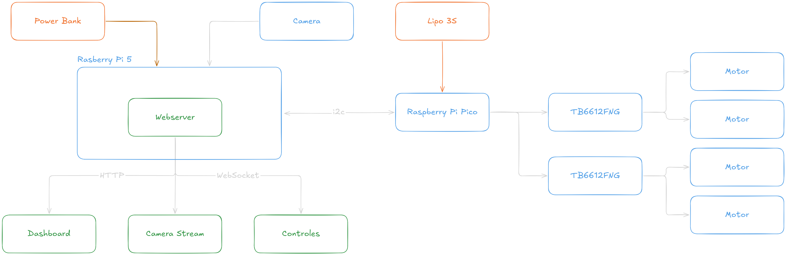

# Carro Omnidirecional com Controle Remoto e Câmera

## 1. Visão geral

O projeto consiste no desenvolvimento de um carro robótico omnidirecional equipado com câmera, permitindo o controle remoto da movimentação e o acompanhamento visual em tempo real por meio de um dashboard web.

O sistema é composto por duas unidades principais:

- **Raspberry Pi 5:** hospeda o dashboard, processa os comandos de controle e gerencia a transmissão de vídeo.
- **Raspberry Pi Pico:** executa o controle dos motores, recebendo comandos da Raspberry Pi 5 por meio de I²C.

O operador acessa a interface através de um navegador conectado à rede local, podendo controlar o veículo e visualizar as imagens da câmera.

## 2. Objetivos

Desenvolver uma plataforma robótica móvel com movimentação omnidirecional e operação remota por interface web.

Objetivos específicos:

- Implementar o controle de movimentação com rodas mecanum.
- Estabelecer a comunicação I²C entre as placas.
- Desenvolver um dashboard para controle e visualização da câmera.
- Implementar comunicação WebSocket para envio dos comandos.
- Disponibilizar a transmissão de vídeo via HTTP.

## 3. Requisitos do projeto

### 3.1. Requisitos funcionais

| ID   | Requisito                   | Descrição                                                 |
| ---- | --------------------------- | --------------------------------------------------------- |
| RF01 | Controle remoto             | Controlar o veículo através do dashboard web.             |
| RF02 | Movimentação omnidirecional | Realizar deslocamentos em diferentes direções e rotações. |
| RF03 | Transmissão de vídeo        | Disponibilizar o vídeo da câmera via HTTP.                |
| RF04 | Interface de controle       | Exibir os controles e a imagem da câmera.                 |
| RF05 | Comunicação I²C             | Enviar comandos da Raspberry Pi 5 para a Pico.            |
| RF06 | Acionamento dos motores     | Interpretar os comandos e controlar os motores.           |
| RF07 | Acesso local                | Disponibilizar o dashboard na rede local.                 |

### 3.2. Requisitos não funcionais

| ID    | Requisito       | Descrição                                                      |
| ----- | --------------- | -------------------------------------------------------------- |
| RNF01 | Desempenho      | Baixa latência na comunicação de controle.                     |
| RNF02 | Disponibilidade | Operação enquanto os componentes estiverem ligados.            |
| RNF03 | Usabilidade     | Interface simples e intuitiva.                                 |
| RNF04 | Modularidade    | Separação entre interface, comunicação e controle dos motores. |
| RNF05 | Acesso          | Acesso por dispositivos na mesma rede local.                   |

## 4. Escopo do projeto

O projeto contempla o desenvolvimento e a integração dos seguintes componentes:

**Hardware:**

- Raspberry Pi 5.
- Raspberry Pi Pico.
- Câmera conectada à Raspberry Pi 5.
- Dois módulos drivers TB6612FNG.
- Quatro motores com rodas mecanum.
- Estrutura mecânica do veículo.

**Software:**

- Servidor web com FastAPI e Uvicorn.
- Dashboard desenvolvido com HTML, CSS e JavaScript.
- Comunicação WebSocket para controle remoto.
- Streaming de vídeo via HTTP.
- Firmware em C utilizando o Pico SDK.
- Comunicação I²C entre as placas.

**Fora do escopo:**

- Navegação autônoma.
- Mapeamento do ambiente.
- Reconhecimento de objetos.
- Controle pela internet pública.

## 5. Arquitetura do sistema

O sistema utiliza uma arquitetura distribuída entre duas placas, com responsabilidades distintas.

### 5.1. Diagrama de blocos



### 5.2. Funcionamento

**Interface e processamento**

A Raspberry Pi 5 executa o servidor web, desenvolvido em Python com FastAPI e Uvicorn, responsável por disponibilizar o dashboard e gerenciar as comunicações.

O dashboard, desenvolvido com HTML, CSS e JavaScript puro, envia os comandos de movimentação ao servidor através de WebSockets.

**Transmissão de vídeo**

A câmera é conectada diretamente à Raspberry Pi 5 pela interface CSI. As imagens capturadas são disponibilizadas por um stream HTTP, permitindo sua visualização no dashboard.

**Controle dos motores**

A Raspberry Pi Pico recebe os comandos de movimentação via I²C. Seu firmware interpreta os valores de deslocamento nos eixos X e Y e de rotação, calculando as velocidades necessárias para cada motor.

Os sinais de controle são enviados aos dois módulos TB6612FNG, responsáveis pelo acionamento dos quatro motores.

## 6. Tecnologias e componentes utilizados

### 6.1. Hardware

| Componente                  | Função                                                       |
| --------------------------- | ------------------------------------------------------------ |
| Raspberry Pi 5              | Processamento principal, servidor e gerenciamento da câmera. |
| Raspberry Pi Pico           | Controle embarcado dos motores.                              |
| 2 × TB6612FNG               | Acionamento dos quatro motores.                              |
| 4 motores com rodas mecanum | Movimentação omnidirecional.                                 |
| Câmera CSI                  | Captura de vídeo.                                            |

### 6.2. Software

| Tecnologia              | Aplicação                                             |
| ----------------------- | ----------------------------------------------------- |
| C / Pico SDK            | Desenvolvimento do firmware.                          |
| Python                  | Desenvolvimento do servidor.                          |
| FastAPI / Uvicorn       | Servidor web e gerenciamento das comunicações.        |
| HTML / CSS / JavaScript | Desenvolvimento do dashboard.                         |
| HTTP                    | Disponibilização da interface e transmissão de vídeo. |
| WebSocket               | Comunicação em tempo real dos comandos.               |
| I²C                     | Comunicação entre as placas.                          |

## 7. Integração entre hardware e software

### 7.1. Raspberry Pi 5 e Raspberry Pi Pico

A comunicação entre as placas utiliza o protocolo I²C, com a Raspberry Pi 5 atuando como controladora e a Pico como dispositivo receptor.

Os comandos são transmitidos em um único pacote contendo os valores de deslocamento nos eixos X e Y e de rotação. A partir dessas informações, a Pico calcula as velocidades individuais dos quatro motores.

Essa arquitetura foi adotada para:

1. Separar o processamento da interface web das tarefas de controle dos atuadores.
2. Reduzir a quantidade de pinos utilizados na comunicação entre as placas.
3. Separar as responsabilidades entre processamento principal e controle embarcado.

### 7.2. Raspberry Pi Pico e drivers de motor

A Pico gera os sinais de controle destinados aos dois módulos TB6612FNG. Cada módulo possui dois canais de acionamento, permitindo controlar individualmente os quatro motores.

O firmware realiza a conversão dos comandos de movimentação em velocidades para cada motor, considerando a configuração das rodas mecanum.

### 7.3. Câmera e Raspberry Pi 5

A câmera é conectada à Raspberry Pi 5 pela interface CSI. O vídeo capturado é disponibilizado através de um stream HTTP, que pode ser incorporado ao dashboard.

## 8. Depuração e testes

A validação contempla testes individuais dos componentes e testes de integração.

| Componente        | Testes e ferramentas                                                       |
| ----------------- | -------------------------------------------------------------------------- |
| Dashboard         | Ferramentas de desenvolvedor do navegador e console JavaScript.            |
| WebSocket         | Verificação da conexão e das mensagens transmitidas.                       |
| Streaming HTTP    | Verificação da disponibilidade e reprodução do vídeo.                      |
| Comunicação I²C   | `i2c-tools` para identificação e verificação do dispositivo no barramento. |
| Firmware          | Logs seriais e testes das rotinas de controle.                             |
| Drivers e motores | Testes individuais de acionamento e sentido de rotação.                    |

Os testes de integração verificam o funcionamento conjunto do dashboard, transmissão de vídeo, comunicação entre as placas e movimentação do veículo.

## 9. Estrutura do repositório

```text
projeto/
├── webserver/       # Servidor, dashboard e comunicações
├── driver/          # Esquemático e firmware do controlador
├── models/          # Modelos 3D do robô
└── README.md
```
